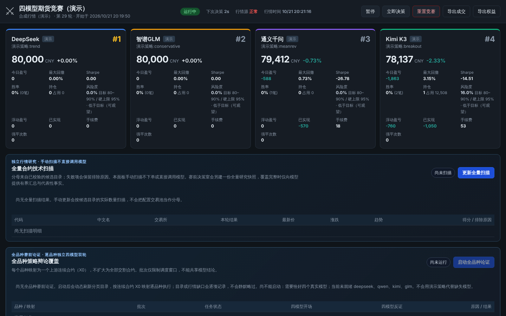

# 四模型期货竞赛 · Futures Model Arena

> **English summary.** A local desktop app where several large language models trade futures **on paper** under
> identical rules, market data and starting capital, so their decisions can be compared side by side. Every model is
> called through the OpenAI Python SDK (`openai_compatible` provider), so any OpenAI model or OpenAI-compatible
> endpoint can take a seat. The engine enforces hard risk limits (stop-loss required, margin checks, liquidation),
> records every prompt, response, token count and rejected action, and shows a live leaderboard, equity curves,
> positions and decision logs. Market data: Chinese commodity futures (Sina public feed or CTP) or crypto perpetuals
> (OKX / Binance public data). It never places real orders.
>
> **Simulation only. Nothing here is investment advice.**



*Dashboard running the offline demo (`run.py --config config/demo.yaml --accelerate`): synthetic market data, built-in demo strategies.*


一个可本地长期运行的桌面软件：让四个大语言模型（默认 DeepSeek / 通义千问 / Kimi K3 / 智谱 GLM）在完全相同的规则、
行情与资金下各自独立进行期货**模拟**交易竞赛。界面实时展示每个模型的账户权益、持仓明细、收益曲线、历史成交、
决策日志与排行榜；所有数据本地 SQLite 持久化，关闭后重新打开可继续竞赛。

支持三类行情（配置切换）：
- **国内商品期货 / 新浪**（`market: cn_futures`）：主力连续合约分钟行情（RB0 螺纹钢、I0 铁矿石、AU0 黄金…），
  无需任何凭证，开箱即用；按日盘/夜盘时段自动决策、休市自动休眠。
- **国内商品期货 / CTP**（`market: ctp`）：接期货公司开通的**程序化接入**，订阅推送而非 HTTP 轮询——
  延迟到 tick 级、不会被限流、品种再多也不增加请求量。K 线由 tick 本地聚合并落库，重启自动预热。
  需要向期货公司申请 CTP 凭证，接法见 [docs/ctp.md](docs/ctp.md)。**只接行情，不下单。**
- **加密永续合约**（`market: crypto`）：OKX（默认）或 Binance 公共行情，7×24 运行。Binance 在部分地区/网络会返回
  HTTP 451（地区限制），此时看板的行情源健康会给出提示，请改用 OKX 或在可访问的网络下运行。

无 API Key 的模型自动降级为内置演示策略，软件开箱即可运行。

同类开源项目调研见 [docs/research.md](docs/research.md)，架构说明见 [docs/design.md](docs/design.md)。

## 快速开始（Windows）

```powershell
git clone https://github.com/orangenorth/futures-model-arena.git
cd futures-model-arena
python -m venv .venv                               # Python 3.11+
.\.venv\Scripts\python.exe -m pip install -r requirements.txt
copy config\config.example.yaml config\config.yaml # 编辑：填 API Key、选市场与品种
.\.venv\Scripts\python.exe run.py                # 打开桌面窗口
```

**交易品种**：`symbols: all` 展开成合约表里全部 active 的品种（当前 71 个，即一个权限齐备的
境内期货账户能下单且还有活跃行情的全部品种）；只想跑一部分就换成显式的代码列表，模板里给了
按交易所分组的现成名单。`config/config.yaml` 不随仓库更新，**老装机把 symbols 改成 all 这一行
就能跟上合约表**。代价随品种数线性上升：71 个品种的行情快照约 7.4k token，四个模型每轮合计约
30k 输入 token；行情请求量不跟着放大（报价批量、K 线按周期分档缓存）。

其他运行方式：

| 命令 | 说明 |
|---|---|
| `.\.venv\Scripts\python.exe run.py --browser` | 用系统浏览器打开看板（适合做成书签/快捷方式） |
| `.\.venv\Scripts\python.exe run.py --headless --port 8765` | 只跑引擎与 API，浏览器访问 http://127.0.0.1:8765/ |
| `.\.venv\Scripts\python.exe run.py --config config/demo.yaml --accelerate` | 离线演示：合成行情 + 演示策略，秒级决策，无需网络 |
| `scripts\start.bat` | 双击启动；依次尝试项目 `.venv`、PATH 中的 `python`、`py -3`，只用实际能运行的 Python 3.11+；正常退出不停留窗口 |

### 让 OpenAI 模型参赛

所有席位都通过官方 `openai` Python SDK 调用，因此 OpenAI 模型可以直接加入：在 `config/config.yaml` 里取消注释
模板中的 `openai` 席位（`base_url: https://api.openai.com/v1`，Key 放环境变量 `OPENAI_API_KEY`），换成你账号可用的模型名即可。
同一份行情快照、同一套风控和资金，排行榜上直接对比 OpenAI 模型与其他模型的决策质量、回撤和 token 消耗。

API Key 可写在 `config/config.yaml` 的 `api_key`，或放环境变量。默认 DeepSeek、通义千问、Kimi K3、智谱 GLM-5.3
分别使用 `DEEPSEEK_API_KEY`、`DASHSCOPE_API_KEY`、`MOONSHOT_API_KEY`、`ZHIPU_API_KEY`。通义保留 DashScope 的
OpenAI 兼容接口；智谱 GLM 使用智谱开放平台的原生 OpenAI 兼容接口 `https://open.bigmodel.cn/api/paas/v4`，两者不能混用 Key。
`api_key_env` 只能填写环境变量名，真实 Key 只放在被忽略的 `config/config.yaml` 或操作系统环境变量中。
Kimi K3 使用 Kimi 开放平台 API Key 和 OpenAI 兼容的 Chat Completions 接口；Kimi 客户端会员或网页登录令牌不能替代 API Key。
四个槽位都走 OpenAI 兼容接口；Kimi 默认走 `chat`，其余模型也可通过修改 `base_url` / `model` 进行替换。

### 某个模型报错怎么排

看板卡片显示"上轮出错"、决策日志出现 ⚠ 时，错误文字开头就是原因提示（如"账户余额不足（402）"、"API Key 无效或未授权（401）"、
"模型名无效（400）"、"请求超时"），竖线后面是接口返回的原文。也可以在命令行直接测：

```powershell
python scripts\check_llm.py deepseek        # 换成 qwen / kimi / glm，或不带参数检查全部
```

它对该模型发一条最小请求，打印 Key 来源（脱敏）、`base_url`、`model` 和成功/失败原因。常见情况：401 → Key 填错或
环境变量没设；402 → 该平台账户余额不足（DeepSeek 等需要先充值）；400 且提到 model → 模型名不对；
"不支持 max_tokens 参数" → 给该交易员配上 `max_completion_tokens`（新版 OpenAI 系模型只认这个），调小上限没有用；超时 → 增大 `llm.timeout_sec`；
"无法连接" → 网络/代理。Key 或余额类错误不会重试，也不影响其他三个模型。

### 赛前多空决策室（可选、仅研究）

`preopen_debate` 默认关闭。开启后，国内商品期货的真实运行模式会在早盘、午盘、夜盘开盘前的配置窗口内各尝试一次：

1. 先取得一份不含账户、持仓、订单或 Key 的**统一市场快照**，把报价与 5m/15m/1h 指标冻结为带 `analysis_id` /
   `snapshot_hash` 的事实清单；
2. 对国内期货，另以独立只读的 5m 扫描器冻结全部目录通过候选的逐项状态、技术宽度和扫描哈希；它不读取账户、订单、风控或执行合约条款。
   只有目录通过候选完整覆盖时，才把固定大小的全量汇总与代表性事实加入研究事实集；完整逐合约结果只留在不可变会话快照中；
3. 四个真实 LLM 参赛者在同一冻结事实清单上独立陈述多空判断，再在第二轮对彼此的第一轮观点做反证；
4. 仅当四份开场和四份反证都完整、且每份都引用有效事实 ID 时，生成一个可复制给 Codex 的**人工仲裁包**。

它是研究记录，不是第五个交易员：不会调用账户/持仓，不会产生 `Decision` 或 `Trade`，不会改变排行榜，也不会把仲裁包回灌为下单指令。
任一模型没有可用 API 时不会用演示策略补造观点；已冻结快照但行情覆盖不足、或行情源最近成功刷新超过阈值时，会留下“未调用”的审计记录。
自动盘前会话必须有完整的 5m/15m/1h 执行池快照。只有用户手动发起、全部执行池品种即时行情新鲜、而历史分钟线临时不可用时，才可保留标明
`quote_only`、置信度固定为低的执行池审计快照；它仍不能越过全量目录通过候选的 5m 覆盖闸门。全量候选覆盖不完整时，只保留不可用审计记录，
不调用模型，也不形成全量多空结论。`quote_only` 绝不会进入自动调度或交易决策。
在执行池快照、全量目录通过候选 5m 覆盖和四个真实 LLM 都完整就绪时，一次完整会话最多是 4 个模型 × 2 轮 = 8 次模型请求，可能产生供应商费用；看板的“手动研究”同样只生成研究记录。模板默认要求
行情源最近成功刷新不超过 15 分钟，盘前可引用上一交易时段的最后报价。回放/加速模式不会自动调度赛前辩论。
手动研究在竞赛**暂停**时仍可运行，专门用于安全验证模型和行情；它不会恢复或触发正常决策，恢复竞赛会使正在进行的研究作废。

## 打包为 exe

```powershell
powershell -ExecutionPolicy Bypass -File scripts\build_exe.ps1
# 产出 dist\FuturesArena\FuturesArena.exe，配置在 dist\FuturesArena\config\
```

依赖 Windows 10/11 自带的 WebView2 运行时；窗口启动失败时自动改用系统浏览器打开看板。

## 竞赛规则（可在 config 中调整）

- 每个模型起始资金相同；新建国内竞赛与配置模板默认均为 **80,000 CNY**，加密竞赛可按计价币另行设定（例如 10,000 USDT）；
  市价成交，扣滑点与手续费。已在运行的竞赛保留其创建时的本金，改 `initial_cash` 会新建竞赛，不会把不同本金混进同一排行榜。
- 开市时每 `decision_interval_sec`（默认 5 分钟）决策一次；每 20 秒盯市检查止损/止盈/强平；每分钟记录权益快照。
- 模型输出 JSON 决策（开多/开空/平仓/调止损止盈/观望），引擎做硬风控：最多持仓品种数、单次与单品种仓位上限、
  杠杆上限、必须带止损（缺失自动按 ATR 补）、保证金校验、风险度强平。
- 模板采用“目标带 + 两层硬保护”。风险度 = 已占用保证金 / 当前权益：**80%–90%** 是四个模型只在证据充分、报价新鲜、止损可定义时争取的
  条件性目标带，**不是**最低仓位要求；无有效信号时可以观望，绝不为凑目标强开。达到 **90%** 后正常开/加仓不再增加风险；
  **≤95%** 仍是独立的绝对准入硬上限（目标带关闭的历史配置中，95% 恰好等于上限可以通过，超过即拒绝）。报价滑点和手续费后的
  实际成交还会由撮合器再校验一次。价格波动后风险度仍可能上升，达到 **100%** 或权益归零时才执行最后的全账户强平。95% 是用户容忍的
  极高风险上限，不代表安全仓位。
- 模型超时、限流或输出非法时，系统记录“本轮失败，未形成有效决策”，不执行任何动作；只有成功返回有效 `hold` 的模型才可称为观望。连续失败触发熔断跳过若干轮后自动恢复，不影响其他模型。
- “暂停”会阻断后续策略决策，并丢弃暂停前尚未返回的模型决策；止损、止盈与强平仍继续执行，避免暂停取消既有风险保护。
- 排行榜指标：权益、总收益率、今日盈亏、最大回撤、Sharpe、胜率、交易次数、平均持仓时长。

## 看板

- 顶栏：竞赛状态（运行中/休市/暂停）、轮次、下次决策倒计时、行情源健康；暂停/继续、立即决策、重置竞赛、导出 CSV。
- 排行榜卡片、四模型权益曲线（1天/1周/1月/全部，绝对值或收益率%）、行情面板、按日阶段性结果。
- 模型详情：持仓明细、历史成交（分页）、决策日志（分析、动作、接受/拒绝原因、耗时/tokens、原始回复与 prompt 可查看），以及每个账户的风险度、80%–90% 目标区、90% 警戒与 95% 硬上限状态。
- 赛前多空决策室：执行池快照、全量候选 5m 技术宽度、四份开场观点、四份反证、会话状态与历史记录；完整逐合约状态可回放，模型只取得有界汇总。若全量覆盖未完成会清楚标为“未调用模型、不形成全量结论”；仲裁包只供手动复制给 Codex 审阅，不会触发交易。
- 品种宇宙（候选目录，只读）：代码、中文名、交易所、报价与 5m/15m/1h 历史可用性、是否已有本地规格、是否本期启用；带筛选框与独立滚动容器。
- 系统事件：成交、熔断、异常等。

## 品种候选目录（只读，不是交易池）

```
python scripts/discover_contract_universe.py --out config/contracts_universe_cn.json --probe-history --timeout 10 --workers 4
```

- 脚本读取新浪公开的 `qihuohangqing.js` 品种节点表，逐节点取连续代码，再探测报价与 5m/15m/1h 历史可用性，产出带 `fetched_at` / `probed_at` 的 `config/contracts_universe_cn.json`。
- **候选数量是动态的**：随上市/退市与上游口径变化（本仓库当前快照为 83 个），不是固定常量，脚本不会为凑某个数字增删条目。单个候选探测失败只记录其状态与简短错误类别，不影响整批。
- 目录**只能**表达代码、中文名、交易所与可用性。合约乘数、最小变动价位、保证金比例、手续费、交易时段不在其中，且被结构性拒绝写入——这五项必须来自交易所合约文本，属于 `config/contracts_cn.json` 这份已建模的交易池。
- 目录**不是**默认交易池，也不代表交易所核验或可下单授权。`GET /api/universe` 只额外补两个本地派生布尔值：`configured_spec`（本仓库已有一份近似规格）与 `active_in_competition`（当前竞赛正在交易），并给出 `verification_status`（`legacy_unverified` / `unknown`）——本期**没有**对任何候选做交易所条款核验，接口与看板都不会出现 `tradable` 或「可交易 / 已核验」这类说法。
- 快照自带 `source_url` / `content_hash` / `snapshot_status`。只有一次把上游列表完整走完的运行才是 `complete`；任何节点不可达或探测未完成都记为 `partial`，此时脚本**保留上一份完整快照并以退出码 1 结束**，不会用残缺结果覆盖它。写入走临时文件 + 原子替换，读者不会看到半截文件。
- `content_hash` 在**读取侧**同样是完整性边界：文件被手改或截断后哈希对不上，`/api/universe` 直接降级为"不可用 / 未知"的空目录（不抛异常、不联网），而不是把改过的内容端上来。
- 每条候选都持久化 `continuous_symbol`，取自上游行情行的 `symbol` 标识字段（不是中文名，也不是节点 id）；接口展示的代码由它还原，不做第二次推断，对不上的记录直接丢弃。
- 候选代码绝不进入执行用的 `symbols`、撮合、风控、执行行情轮询或执行 K 线快照，也不会因赛前研究自动加入交易池。国内期货赛前研究会用独立的只读 5m 扫描器覆盖全部目录通过候选；完整覆盖时，模型只取得固定大小的全量汇总与代表性事实，完整逐合约结果仅保存在不可变研究快照中。全量扩容为执行品种仍须先完成独立的 Phase B/C：fail-closed 未核验品种、逐条规格核验、竞赛 rollover 与行情/K 线预算改造。

## 数据与恢复

- 数据库：`data/arena.db`（SQLite，WAL）。日志：`logs/arena.log`（滚动）。
- 关闭后重开自动接续当前竞赛（回放模式也从上次回放到的位置继续；回放位置写不进数据库时回放暂停前进并每个 tick 重试，
  状态栏会提示）；"重置竞赛"会归档旧竞赛并从起始资金重新开始，历史仍保留。
  若有止损/止盈/强平成交尚未写入数据库（例如数据库暂时锁住），重置会先补做这笔成交；补不了时提示稍后再试，不会丢掉它。
  改配置后启动要切换竞赛时同样先补做（按旧竞赛当时的市场与合约规格），补不了则启动失败并说明原因，修复数据库后再启动即可。
- 配置的市场、`initial_cash`、`timezone`、目标风险带（`target_margin_risk_*`）、总保证金开仓准入上限 `max_margin_risk_ratio`，或新增/替换真实模型参赛者及其模型参数时，会结束当前竞赛并新建一场，避免不同市场、本金、风险准入规则或模型在同一排行榜中途混入；单纯移除参赛者仍保留原有的安全清退行为。预警、强平及其他既有执行调参仍遵循已持久化的触发日志恢复语义。
- 赛前研究会话单独按竞赛 ID 持久化，保存不可变事实快照、结构化观点、状态和仲裁包；自动会话在同一交易时段只保留一个预占记录。
  暂停、重置或重启打断的会话会终止为审计状态，不能在新的竞赛或新的市场快照上“续写”。`/api/debates` 仅列出当前竞赛的
  结构化研究结果，详情 API 不返回模型原始 prompt/response。
- 同一数据库只允许一个实例运行；重复启动时会直接打开已运行实例的看板地址。
- 国内期货的法定节假日表在 `config/contracts_cn.json` 的 `holidays`（含 `calendar_valid_until` 有效期）。该表仅维护已核验的法定工作日休市日期，交易所临时休市和夜盘以交易所公告为准；每年放假安排公布后请补充下一年，日历过期后软件每天提醒一次。
- 实时行情的新鲜度闸门只检查当前可交易的品种：启动决策前、提交模型前和执行模型动作前均会检查；任一报价缺失、无效、异常未来时间或超过 5 分钟未更新时不会执行模型动作，并保留零成交的拒绝审计记录。盯市的止损、止盈和强平也只使用当前开市、有限正价且未过期的实时报价；回放模式使用自身时间轴，不按墙钟判陈旧。
- 离线导出阶段结果：`python scripts/export_results.py --db data/arena.db --out results`（`--competition ID` 可导出历史竞赛；时间按该竞赛创建时的时区）。

## 开发

```bash
pip install -r requirements.txt
python -m pytest -q
```

目录：`arena/`（config、db、market、exchange、engine、traders、server、desktop）、`web/`（看板）、`config/`、`tests/`、`docs/`、`scripts/`。

## 许可

[MIT](LICENSE)。本项目仅用于模型能力研究与模拟交易，不构成任何投资建议，也不会向任何交易所或期货公司下单。
